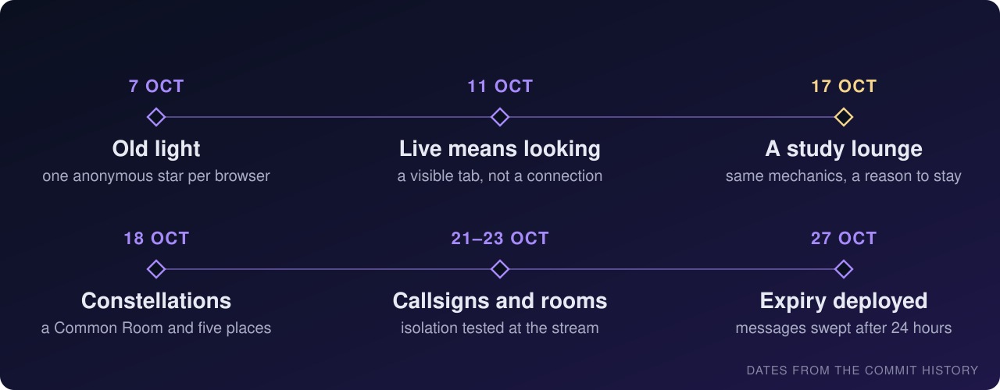

# Process overview

    

<a href="#from-old-light-to-a-study-lounge">Concept</a> · <a href="#a-small-stack-on-one-machine">Stack</a> · <a href="#directing-and-correcting-the-agent">Agent</a> · <a href="#rules-that-became-tests">Tests</a> · <a href="#operational-mistakes">Mistakes</a> · <a href="#deliberate-limits">Limits</a> · <a href="README.md">README</a>

---

Building Overlap was less about features than about deciding what the app may honestly claim about people, then making the server and its tests hold to that.

## From old light to a study lounge

Overlap began as an artwork about *old light* ([`c4f5559`](https://github.com/comp4020-agentic-coding-studio/comp4020-final-mukulsharma0260-alt/commit/c4f5559)): each anonymous browser kept one star, and its brightness recorded how long ago that browser was last seen. In [ADR 0007](docs/adr/0007-overlap-becomes-a-study-lounge.md) I concluded that it had an atmosphere, but not an occasion: nothing told a visitor why they might keep it open. Late-night study gave the same mechanics a reason ([`5e131af`](https://github.com/comp4020-agentic-coding-studio/comp4020-final-mukulsharma0260-alt/commit/5e131af)). The mechanics stayed; the vocabulary changed, fixed in `docs/terms.md` ([`0d3466c`](https://github.com/comp4020-agentic-coding-studio/comp4020-final-mukulsharma0260-alt/commit/0d3466c)).

| Alternative | Why I turned it down | Record |
|---|---|---|
| A general social space | Pulls towards names, reactions and feeds | [ADR 0007](docs/adr/0007-overlap-becomes-a-study-lounge.md) |
| A "study nearby" filter | Would leak where people are; a test checks no location column exists | [`c17045b`](https://github.com/comp4020-agentic-coding-studio/comp4020-final-mukulsharma0260-alt/commit/c17045b), [proposal](docs/proposals/distance-filter.md) |
| An Observatory of glowing visitors only | Turned everyone else into numbers and hid the shared place | [ADR 0010](docs/adr/0010-five-fixed-constellations-on-the-star.md) |

## Making company legible

The first lounge drew every star as an equal dot. Locally there were more than 400, mostly from automated tests and screenshot runs, and nobody could tell where to go. After I rejected the Observatory, the Common Room became the default view, with five constellations as optional places for a star. Then each constellation became its own full-screen view, because focusing a region "did not feel like going anywhere" ([`8d3daeb`](https://github.com/comp4020-agentic-coding-studio/comp4020-final-mukulsharma0260-alt/commit/8d3daeb)). Looking at a populated screenshot found a real bug: every newcomer settling in Engineering landed on one point, because the client sent the region's centre. The server now gives such a star its own spot from its id, and a test reproduces the stack ([notes](docs/process-notes-constellations.md)).

---

## A small stack on one machine

I chose a plain Node server, Node's built-in SQLite, server-sent events and vanilla JavaScript ([ADR 0002](docs/adr/0002-plain-node-and-built-in-sqlite-on-one-fly-machine.md)). SSE fits because the server mostly pushes changes out while ordinary POSTs carry actions. Identity is an HttpOnly cookie whose SHA-256 hash is the only thing stored, so a request body never proves ownership ([ADR 0001](docs/adr/0001-durable-anonymous-stars.md)).

The trade-off is one machine. The Fly volume holds the only copy of the data. Presence, the SSE bus and chat rate limits live in one process's memory, so a second machine sees a different lounge. I raised Fly's connection limit for long-lived streams ([`5dfc3ce`](https://github.com/comp4020-agentic-coding-studio/comp4020-final-mukulsharma0260-alt/commit/5dfc3ce)), but I have not tested scaling out and do not claim it.

## Directing and correcting the agent

I wrote the first `CLAUDE.md` rules in the first hour of code ([`69dc04e`](https://github.com/comp4020-agentic-coding-studio/comp4020-final-mukulsharma0260-alt/commit/69dc04e)), approved plans before implementation, and reviewed plans in a separate Claude chat. The agent wrote most of the code; these are places I changed its direction.

- **The wrong question.** My first real-time decision record compared transports when the question was what "live" may mean. I superseded it ([`6c3f397`](https://github.com/comp4020-agentic-coding-studio/comp4020-final-mukulsharma0260-alt/commit/6c3f397)) and kept no grace period, so a reload briefly dims a star.
- **Callsigns off the star.** An early plan stored callsigns on the star. It was rejected before any code, because a visitor must be able to choose a callsign first, so callsigns became their own table keyed by the identity hash ([`acff055`](https://github.com/comp4020-agentic-coding-studio/comp4020-final-mukulsharma0260-alt/commit/acff055)). That design exposed a real bug, a second cookie minted for one browser, fixed in [`b446a75`](https://github.com/comp4020-agentic-coding-studio/comp4020-final-mukulsharma0260-alt/commit/b446a75).
- **Isolation before features.** When the agent proposed deferring isolation tests until constellation conversations existed, I asked for room-scoped delivery and its tests first. The room registry and its tests landed before any server code used them ([`6800a12`](https://github.com/comp4020-agentic-coding-studio/comp4020-final-mukulsharma0260-alt/commit/6800a12)).

---

## Rules that became tests

| Rule | Server | Test | What it shows, and does not |
|---|---|---|---|
| **Ownership** | Star resolved only from the cookie | `spec/audit.test.ts`, `spec/settle.test.ts` | When B sends A's star id, only B's star moves and the log names B ([`20e8651`](https://github.com/comp4020-agentic-coding-studio/comp4020-final-mukulsharma0260-alt/commit/20e8651)). Not a general security audit. |
| **Isolation** | `src/chat-rooms.ts`, re-checked on every post | `spec/chat-subject-rooms.test.ts` | An Engineering message is absent from every raw frame of a Science stream ([`96bd3d0`](https://github.com/comp4020-agentic-coding-studio/comp4020-final-mukulsharma0260-alt/commit/96bd3d0), [`daad6e5`](https://github.com/comp4020-agentic-coding-studio/comp4020-final-mukulsharma0260-alt/commit/daad6e5)). Covers the rooms tested, not every pair. |
| **Callsign independence** | Own table, keyed by identity hash | `spec/callsign.test.ts` | A callsign needs no star; a later star reuses the identity ([ADR 0012](docs/adr/0012-anonymous-callsigns.md)). |

Reverting the room membership turned the isolation test red ([ADR 0012](docs/adr/0012-anonymous-callsigns.md)).

See the intermittent failures that turned out to be real

The rule that a test passing on rerun is still failing found three causes:

- a same-millisecond miscount, fixed by ordering on insertion rather than timestamps ([`9172d4c`](https://github.com/comp4020-agentic-coding-studio/comp4020-final-mukulsharma0260-alt/commit/9172d4c));
- SQLite reusing a deleted rowid, fixed with a counter that never goes backwards ([`6d391af`](https://github.com/comp4020-agentic-coding-studio/comp4020-final-mukulsharma0260-alt/commit/6d391af)); and
- test files racing on one server: a check failed in 3 of 4 full runs but passed alone, so spec files now run one at a time ([`4a800a9`](https://github.com/comp4020-agentic-coding-studio/comp4020-final-mukulsharma0260-alt/commit/4a800a9)).

---

## Operational mistakes

A live check after an early deploy created a stray production star; I backed up, deleted it, and required live checks to be read-only or clean up after themselves ([`daa48e3`](https://github.com/comp4020-agentic-coding-studio/comp4020-final-mukulsharma0260-alt/commit/daa48e3)). Later, an end-to-end callsign check created a durable star and callsign. With no delete path, cleanup was impossible. I left the harmless anonymous trace, and live checks are now read-only unless I explicitly approve a write ([`b85ce60`](https://github.com/comp4020-agentic-coding-studio/comp4020-final-mukulsharma0260-alt/commit/b85ce60)). The mobile layout check places stars, so it now refuses any host but localhost ([`0e0c763`](https://github.com/comp4020-agentic-coding-studio/comp4020-final-mukulsharma0260-alt/commit/0e0c763)).

A backup must follow a WAL checkpoint ([`4dbb8f0`](https://github.com/comp4020-agentic-coding-studio/comp4020-final-mukulsharma0260-alt/commit/4dbb8f0)), and local copies stay out of git ([`78b28e8`](https://github.com/comp4020-agentic-coding-studio/comp4020-final-mukulsharma0260-alt/commit/78b28e8)). When chat's migration shipped, a push deployed automatically before the backup I intended, so that backup came after the deploy. No data was lost, but `CLAUDE.md` now says a push to `main` is a deploy ([`b85ce60`](https://github.com/comp4020-agentic-coding-studio/comp4020-final-mukulsharma0260-alt/commit/b85ce60)).

## Deliberate limits

Message expiry is four separate claims:

1. **Not returned.** An expired message is never returned by any read path.
2. **Removed live.** Open conversations drop it when the sweep announces it ([`2d76936`](https://github.com/comp4020-agentic-coding-studio/comp4020-final-mukulsharma0260-alt/commit/2d76936)).
3. **Deleted.** A server sweep deletes the row ([`40b7800`](https://github.com/comp4020-agentic-coding-studio/comp4020-final-mukulsharma0260-alt/commit/40b7800)), deployed on 27 October ([`cb00e59`](https://github.com/comp4020-agentic-coding-studio/comp4020-final-mukulsharma0260-alt/commit/cb00e59)). The sweep runs only while the machine is awake, so deletion can lag after an idle night.
4. **Not erased from copies.** Expired rows may survive in volume snapshots and backups.

There is no moderation or report path, and callsigns are never released. No one outside the project has tested the lounge, and the media credits rest on my own declaration ([`9819c87`](https://github.com/comp4020-agentic-coding-studio/comp4020-final-mukulsharma0260-alt/commit/9819c87)).

---

