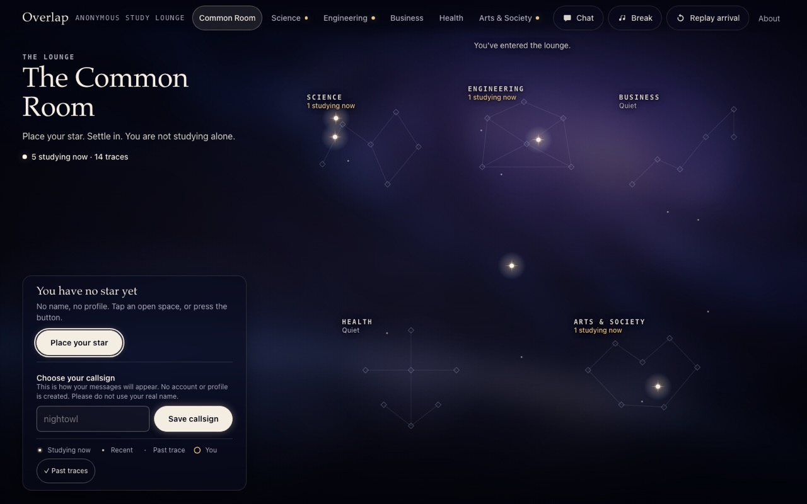

# Overlap

     

**Overlap is an anonymous study lounge for students studying alone, especially late at night.**

To try it as two people, open [the live lounge](https://comp4020-final-mukulsharma0260-alt.fly.dev/) in a normal window and a private one; two tabs are one person.

<a href="https://comp4020-final-mukulsharma0260-alt.fly.dev/"><strong>Enter the lounge</strong></a> · <a href="https://github.com/comp4020-agentic-coding-studio/comp4020-final-mukulsharma0260-alt/blob/main/PROCESS.md">Process</a> · <a href="https://github.com/comp4020-agentic-coding-studio/comp4020-final-mukulsharma0260-alt/tree/main/docs/adr">Decisions</a>

---

## What good means here

Studying alone late is easier when you can tell others are doing the same. Most places that show you other people ask you to perform: a profile, followers, a streak. Good, here, means glancing at the lounge, seeing others studying too, and going back to work less alone, without being asked to say or prove anything.

Goffman's public co-presence and Erickson and Kellogg's social translucence name this: people noticing each other without performing. Robin Sloan's home-cooked app kept the scale small: a place for a class or some friends on one evening, not a platform.

## How the lounge works

Local build: every star is a synthetic test browser.

1. Press **Enter the Lounge**; until then nothing counts.
2. Place one star in the Common Room, or settle it in Science, Engineering, Business, Health, or Arts & Society. An anonymous cookie, not an account, gives your browser its star back.
3. A star glows while its visitor has the lounge open in a visible tab. That says a browser is showing the lounge, not who or where the person is, or whether they are at their desk.
4. Optionally choose a callsign. It belongs to your browser, not your star, so it can come first. It is unique and permanent, so do not use your real name.
5. Talk a little in the Common Room, or in your constellation's conversation, which only visitors settled there can join. Messages are at most 280 characters and expire after 24 hours.

## What I chose not to build

Overlap began as an artwork about old light; I dropped it because nothing gave visitors a reason to stay. I rejected a general social space, which pulls towards names, reactions and feeds, and a "study nearby" filter, which would leak where people are. There are no direct messages, profiles, likes, feeds, streaks, permanent chat history, or location.

## Enforced: each has a check

| Enforced | Check |
|---|---|
| Opening the page creates no star and no cookie | `spec/stars.test.ts` |
| Only the browser that placed a star can move it | `spec/settle.test.ts` |
| A placed or moved star reaches another browser within a second; tabs share one star | `spec/realtime.test.ts` |
| A callsign needs no star, and no two visitors share one | `spec/callsign.test.ts` |
| A constellation's messages reach only visitors settled there | `spec/chat-subject-rooms.test.ts` |
| Messages render as text, posting is rate-limited, and expired messages are never returned | `spec/chat*.test.ts` |
| Cookies, their hashes and others' exact times never appear in pages or live updates | `spec/stars.test.ts`, `spec/realtime.test.ts` |

## Judged: needs people

Whether the lounge feels calm rather than empty, reads at a glance, and feels like company, not surveillance. No one outside class has judged it yet; [the testing protocol](https://github.com/comp4020-agentic-coding-studio/comp4020-final-mukulsharma0260-alt/blob/main/docs/evidence/friend-testing.md) says how they will.

## Known limits

Overlap runs on one Fly.io machine, with stars in SQLite on its volume and live state in memory; a second machine would see a different lounge. A restart briefly forgets who glows; expired messages may survive in backups. There is no account recovery or moderation.

## Sources

- Erving Goffman, [*Behavior in Public Places*](https://books.google.com/books?id=-4zZAAAAMAAJ), 1963.
- Thomas Erickson and Wendy Kellogg, [“Social Translucence”](https://doi.org/10.1145/344949.345004), 2000.
- Robin Sloan, [“An App Can Be a Home-Cooked Meal”](https://www.robinsloan.com/notes/home-cooked-app/), 2020.

---

